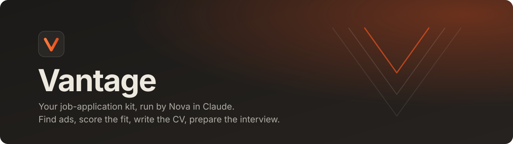
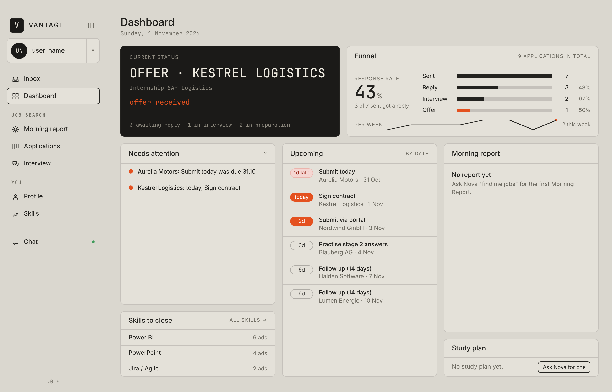
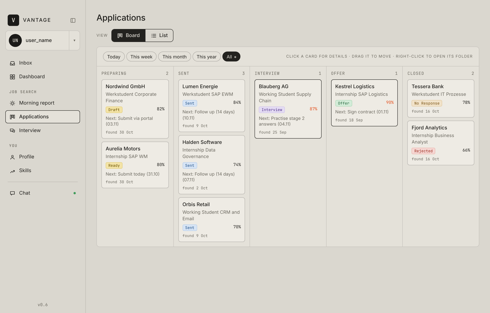
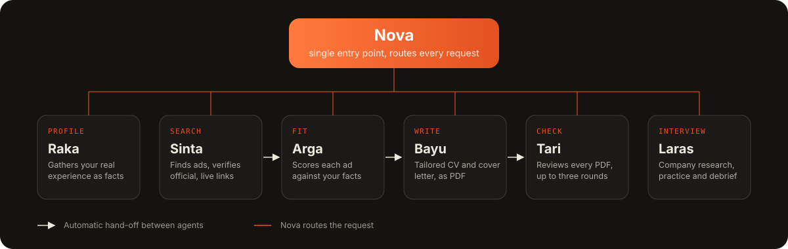

<p align="center">
  
</p>

<p align="center">
  <a href="https://github.com/helm1zf/vantage/releases/latest"></a>
  <a href="https://github.com/helm1zf/vantage/actions/workflows/release.yml"></a>
  
  <a href="LICENSE"></a>
</p>

<p align="center">
  <a href="#tangkapan-layar">Tangkapan layar</a> &nbsp;/&nbsp;
  <a href="#instalasi">Instalasi</a> &nbsp;/&nbsp;
  <a href="#fitur">Fitur</a> &nbsp;/&nbsp;
  <a href="#cara-kerja">Cara kerja</a> &nbsp;/&nbsp;
  <a href="#privasi">Privasi</a> &nbsp;/&nbsp;
  <a href="#pengembangan">Pengembangan</a>
</p>

<p align="center"><sub><a href="README.md">English</a> &nbsp;|&nbsp; Bahasa Indonesia</sub></p>

---

Vantage adalah aplikasi desktop dan kit asisten untuk mengelola pencarian kerja. Nova, asisten yang berjalan di dalam
Claude, mencari lowongan, menilai seberapa cocok tiap lowongan denganmu, menulis CV dan surat lamaran yang disesuaikan,
lalu menyiapkanmu untuk wawancara. Aplikasi Vantage menampilkan semuanya dalam satu layar.

Aplikasinya tersedia dalam bahasa Inggris, Jerman, dan Indonesia, dan bahasanya bisa diganti kapan saja lewat menu pengguna.
Nova berbicara dalam Bahasa Indonesia. Kit ini dirancang untuk pencari kerja berbahasa Indonesia yang melamar posisi
Werkstudent, magang, dan posisi pemula di Jerman. Bagian yang hanya relevan untuk konteks itu, misalnya topik izin kerja
pada persiapan wawancara, dilewati kalau tidak berlaku untukmu.

## Tangkapan layar

<p align="center">
  
</p>

<p align="center">
  
</p>

<sub>Ditampilkan dengan data contoh bawaan aplikasi. Repositori ini tidak berisi data lamaran atau data pribadi yang asli.</sub>

## Instalasi

Di aplikasi Claude, buka **Code** lalu kirim:

```text
Please install Vantage from this link: https://github.com/helm1zf/vantage
```

Claude mengunduh installer jadi untuk sistemmu dari [rilis terbaru](https://github.com/helm1zf/vantage/releases/latest),
memasang aplikasi, membuat folder Vantage-mu, lalu menawarkan untuk melanjutkan sebagai Nova di percakapan yang sama.
Kamu hanya perlu menyetujui permintaan izin yang muncul (di Windows juga prompt sistem). Waktunya sekitar 10 menit.

Prosedur lengkap yang diikuti Claude ada di [INSTALL.md](INSTALL.md) (dalam bahasa Inggris). Baca dulu kalau kamu ingin
tahu persis apa yang akan dijalankan di komputermu.

### Apa yang dilakukan installer

- Membaca rilis terbaru repositori ini dan mengunduh installer untuk sistemmu (`.dmg` untuk macOS, Apple Silicon atau
  Intel, dan `-setup.exe` untuk Windows) beserta `Vantage_Kit.zip`. File disimpan di folder pendek (`~/Developer/VantageApp`
  atau `%USERPROFILE%\VantageApp`). Git tidak diperlukan.
- Memasang aplikasi: `/Applications/Vantage.app` di macOS, atau menjalankan program setup secara senyap di Windows.
- Membuat folder data Vantage dan menyalin kit ke dalamnya: `~/Documents/Vantage` di macOS dan `%USERPROFILE%\Vantage`
  di Windows (di luar OneDrive, supaya tidak ada masalah sinkronisasi dan path yang terlalu panjang). Pada instalasi
  ulang, folder pribadimu tidak pernah disentuh.
- Memeriksa Python 3 (dipasang lewat `winget` di Windows kalau belum ada) dan memasang beberapa pustaka Python hanya
  untuk pengguna saat ini: `python-docx`, `openpyxl`, `markdown`, `pypdf`, dan `Pillow`. Dipakai untuk membuat PDF dan
  tracker Excel.
- Menghapus file unduhan sementara setelah selesai, dan bertanya dulu sebelum menjalankan Nova.
- Tidak pernah meminta atau menyimpan kata sandi. Kalau sistem yang memintanya, kamu mengetiknya di sana.

### Aplikasinya belum ditandatangani

Vantage belum ditandatangani atau dinotarisasi oleh Apple maupun Microsoft, jadi kedua sistem biasanya memblokirnya saat
pertama dibuka. Agar instalasi bisa berjalan, Claude menghapus tanda unduhan di macOS (`xattr -dr com.apple.quarantine`)
dan membuka blokir file di Windows (`Unblock-File`) sebelum menjalankan installer, dan Claude memberi tahu kamu saat
melakukannya. Kalau SmartScreen Windows tetap muncul, pilih **More info**, lalu **Run anyway**.

Kalau kamu tidak mau melewati pemeriksaan itu, kamu bisa membangun aplikasi dari sumbernya, yang terbuka di macOS tanpa
peringatan (lihat [Pengembangan](#pengembangan)). Instalasi otomatis juga beralih ke build dari sumber kalau installer
rilis tidak tersedia atau gagal. Jalur itu butuh lebih banyak alat (Xcode Command Line Tools, Node.js, dan Rust di
macOS; Git, Node.js, Rust, dan Visual Studio C++ build tools di Windows) dan beberapa GB ruang disk.

## Fitur

| Area | Deskripsi |
|---|---|
| Inbox | Taruh file atau folder apa saja. Nova memilahnya ke dokumenmu. Semua jenis file dan file besar didukung, penyalinan berjalan di latar belakang. |
| Dashboard | Status terkini, tingkat respons, hal yang butuh perhatian, tugas mendatang, skill yang perlu dikejar, dan rencana belajar. |
| Morning report | Lowongan harian yang cocok dengan profilmu, masing-masing dengan skor kecocokan. Atur kata kunci, lokasi, jenis kontrak, dan ambang skor, atau jalankan laporan kapan saja. |
| Applications | Tampilan papan (Preparing, Sent, Interview, Offer, Closed) dan tampilan daftar, lengkap dengan dokumen tiap lamaran. |
| Interview | Persiapan per lamaran, dari riset perusahaan sampai latihan tanya jawab dan evaluasi. |
| Profile dan Skills | Bahan sumber, Master CV, CV contoh peran, dan kesenjangan skill dari lowongan yang sudah dianalisis, beserta rencana belajar. |
| Chat | Claude di dalam jendela Vantage. |

## Cara kerja

Nova adalah satu pintu masuk. Setiap permintaan diarahkan ke agen spesialis yang bertanggung jawab.

<p align="center">
  
</p>

| Agen | Tanggung jawab |
|---|---|
| Raka | Mewawancarai pengalamanmu, memproses bahanmu, dan satu-satunya agen yang menulis ke basis faktamu. |
| Sinta | Mencari lowongan yang cocok dengan profilmu dan memastikan tautan mengarah ke halaman resmi perusahaan dan masih aktif. |
| Arga | Membaca tiap lowongan, memetakan setiap persyaratan ke bukti di faktamu, dan menilai kecocokan dengan satu rubrik (ambang bawaan 80). |
| Bayu | Menulis CV dan surat lamaran yang disesuaikan dari bukti tersebut, lalu mengekspornya sebagai PDF. |
| Tari | Memeriksa setiap PDF buatan Bayu dan mengembalikan hasil lulus atau daftar perbaikan bernomor, maksimal tiga putaran. |
| Laras | Meriset perusahaan dan pewawancara, menjalankan latihan dengan intensitas pilihanmu, dan mengevaluasi sesudahnya. |

Dokumen ditulis dari bukti di basis faktamu sendiri, bukan dari templat generik.

## Pembaruan

Aplikasi memperbarui dirinya sendiri. Saat versi baru siap, sebuah banner menawarkan restart, dan *What's new*
menampilkan daftar perubahan. Pembaruan file Vantage di foldermu dilakukan Nova saat aplikasi menampilkan *Vantage
update available*. Materi, lamaran, dan laporanmu tidak pernah ditimpa.

## Privasi

- Semua data disimpan di `Documents/Vantage` di komputermu sendiri.
- Aplikasi hanya menulis salinan Inbox dan pengaturanmu. Selebihnya ditangani Nova di chat.
- Tidak ada yang dikirim ke mana pun tanpa konfirmasimu.

## Pengembangan

Vantage dibangun dengan [Tauri v2](https://tauri.app): shell Rust di `src-tauri/` dan antarmuka HTML, CSS, dan
JavaScript biasa di `ui/`. Direktori `kit/` adalah templat yang dipasang ke folder Documents pengguna.

```text
.
├── ui/              antarmuka (index.html, app.js, style.css, i18n.js, strings.js, tour.js)
├── src-tauri/       shell Tauri, konfigurasi, dan capabilities
├── kit/             agen, prosedur, fase, onboarding, dan skrip Python (juga tertanam di aplikasi)
├── tools/           alat bantu publikasi dan pemeriksaan terjemahan
├── docs/assets/     gambar yang dipakai di README
├── .github/         workflow rilis
├── INSTALL.md       instruksi instalasi untuk Claude
└── vantage.json     pengaturan publikasi (github_repo)
```

Untuk menjalankan secara lokal kamu butuh [Node.js](https://nodejs.org) dan [Rust toolchain](https://rustup.rs):

```bash
npm install
npx tauri icon app-icon.png   # ikon dibuat otomatis dan tidak di-commit
npm run dev
```

### Merilis versi baru

1. Perbarui `RELEASE_NOTES.md` dan versi di `src-tauri/tauri.conf.json` serta `src-tauri/Cargo.toml`.
2. Push tag seperti `v0.6.0`.
3. [Workflow rilis](.github/workflows/release.yml) membangun macOS (Apple Silicon dan Intel) dan Windows, menandatangani
   file pembaruan, dan menerbitkan rilis beserta `latest.json` dan `Vantage_Kit.zip`. Aplikasi yang terpasang
   menemukannya saat dibuka berikutnya.

Kunci penandatangan updater disimpan sekali sebagai secret repositori `TAURI_SIGNING_PRIVATE_KEY` di Settings, Secrets
and variables, Actions. Kunci itu tidak memakai kata sandi. Kunci privat tidak pernah di-commit ke repositori ini.

## Lisensi

Dirilis di bawah [Lisensi MIT](LICENSE). Hak cipta (c) 2026 punktepy.
