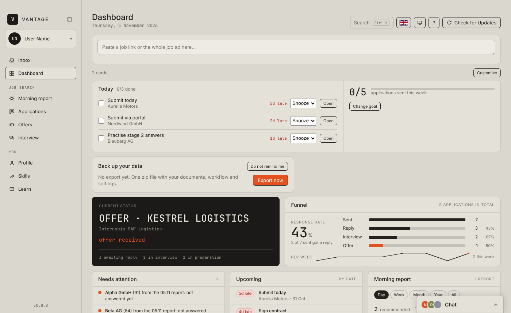
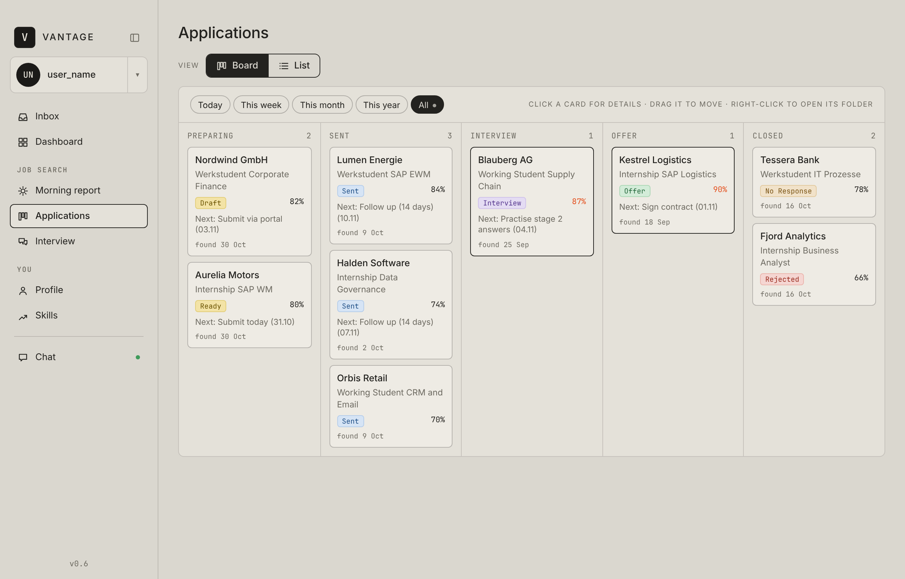
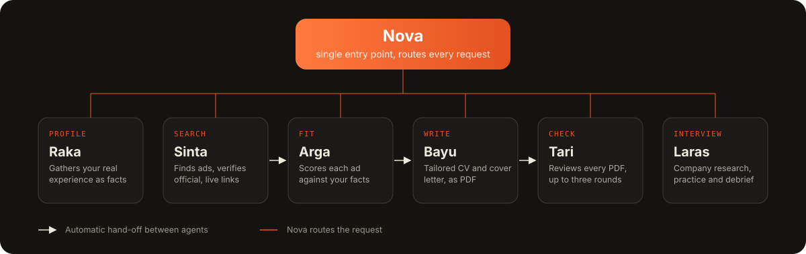

<p align="center">
  
</p>

<p align="center">
  <a href="https://github.com/helm1zf/vantage/releases/latest"></a>
  <a href="https://github.com/helm1zf/vantage/actions/workflows/release.yml"></a>
  
  <a href="LICENSE"></a>
</p>

<p align="center">
  <a href="#screenshots">Screenshots</a> &nbsp;/&nbsp;
  <a href="#installation">Installation</a> &nbsp;/&nbsp;
  <a href="#features">Features</a> &nbsp;/&nbsp;
  <a href="#how-it-works">How it works</a> &nbsp;/&nbsp;
  <a href="#privacy">Privacy</a> &nbsp;/&nbsp;
  <a href="#development">Development</a>
</p>

<p align="center"><sub>English &nbsp;|&nbsp; <a href="README.id.md">Bahasa Indonesia</a></sub></p>

---

Vantage is a desktop application and assistant kit for managing a job search. Nova, an assistant that runs in
Claude, finds job ads, scores how well each one fits you, writes a tailored CV and cover letter, and prepares you for
the interview. The Vantage app brings the result together on a single screen.

The app is available in English, German and Indonesian, and you can switch language at any time from the user menu.
Nova speaks Bahasa Indonesia. The kit is designed for Indonesian-speaking applicants seeking working-student,
internship and entry-level positions in Germany. Sections that apply only to that context, such as work-permit topics
in interview preparation, are skipped when they do not apply to you.

## Screenshots

<p align="center">
  
</p>

<p align="center">
  
</p>

<sub>Shown with the built-in sample data. No real applications or personal data are included in this repository.</sub>

## Installation

In the Claude app, open **Code** and send:

```text
Please install Vantage from this link: https://github.com/helm1zf/vantage
```

Claude downloads the prebuilt installer for your system from the
[latest release](https://github.com/helm1zf/vantage/releases/latest), installs the app, creates your Vantage folder,
and then offers to continue as Nova in the same conversation. You only need to approve the permission prompts (and, on
Windows, the system prompts) as they appear. It takes about 10 minutes.

The full procedure Claude follows is documented in [INSTALL.md](INSTALL.md). Read it first if you want to know exactly
what will run on your computer.

### What the installer does

- Reads the latest release of this repository and downloads the installer for your system (a `.dmg` for macOS on
  Apple Silicon or Intel, a `-setup.exe` for Windows) together with `Vantage_Kit.zip`. Files go into a short folder
  (`~/Developer/VantageApp` or `%USERPROFILE%\VantageApp`). Git is not required.
- Installs the app: `/Applications/Vantage.app` on macOS, or runs the setup program silently on Windows.
- Creates your Vantage data folder and copies the kit into it: `~/Documents/Vantage` on macOS and
  `%USERPROFILE%\Vantage` on Windows (outside OneDrive, to avoid sync and long-path problems). On later runs your
  personal folders are never touched.
- Checks for Python 3 (installed through `winget` on Windows if it is missing) and installs a few Python libraries for
  the current user only: `python-docx`, `openpyxl`, `markdown`, `pypdf` and `Pillow`. They are used to produce PDFs and
  the Excel tracker.
- Deletes its temporary download files when it is done, and asks before starting Nova.
- Never asks for or stores a password. If the system itself asks for one, you enter it there.

### The app is not signed

Vantage is not signed or notarized by Apple or Microsoft, so both systems would normally block it on first launch. To
let the install go through, Claude removes the download mark on macOS (`xattr -dr com.apple.quarantine`) and unblocks
the file on Windows (`Unblock-File`) before running the installer, and it tells you when it does so. If Windows
SmartScreen still appears, choose **More info**, then **Run anyway**.

If you would rather not bypass these checks, you can build the app from source, which opens on macOS without a warning
(see [Development](#development)). The automated install also falls back to a source build when no release installer is
available or the installer fails. That path needs more tools (Xcode Command Line Tools, Node.js and Rust on macOS;
Git, Node.js, Rust and the Visual Studio C++ build tools on Windows) and several GB of disk space.

## Features

| Area | Description |
|---|---|
| Inbox | Drop in any files or folders. Nova sorts them into your documents. Any file type and large files are supported, and copying runs in the background. |
| Dashboard | Current status, response rate, items needing attention, upcoming tasks, skills to close and your study plan. |
| Morning report | Daily job ads that fit your profile, each with a match score. Configure keywords, locations, contract types and threshold, or run the report on demand. |
| Applications | Board view (Preparing, Sent, Interview, Offer, Closed) and list view, with the documents for each application. |
| Interview | Preparation per application, from company research to practice rounds and debriefing. |
| Profile and Skills | Source materials, Master CV, role-model CVs, and skill gaps found in the ads you analysed, with study plans. |
| Nova | Four chats inside Vantage: Nova (ask anything), Raka (your profile), the Applications group (job search, CVs, checks) and Laras (interview practice). Runs on your own Claude Code with a Claude Pro or Max plan; each reply shows its share of your plan limits. |

## How it works

Nova is the single entry point. Each request is routed to the specialist agent responsible for it.

<p align="center">
  
</p>

| Agent | Responsibility |
|---|---|
| Raka | Interviews you about your experience, processes your materials, and is the only agent that writes to your fact base. |
| Sinta | Searches for ads matching your profile and verifies that links point to the employer's own page and are still live. |
| Arga | Reads each ad, maps every requirement to evidence in your facts, and scores the fit against a single rubric (default threshold 80). |
| Bayu | Writes the tailored CV and cover letter from that evidence and exports them as PDF. |
| Tari | Reviews each PDF Bayu produces and returns either a pass or a numbered list of fixes, for up to three rounds. |
| Laras | Researches the company and interviewer, runs practice sessions at the intensity you choose, and debriefs afterwards. |

Documents are written from evidence in your own fact base rather than from generic templates.

## Updates

The application updates itself. When a new version is ready, a banner offers a restart, and *What's new* lists the
changes. Updates to the Vantage files in your folder are applied by Nova when the app shows *Vantage update
available*. Your materials, applications and reports are never overwritten.

## Privacy

- All data is stored in `Documents/Vantage` on your own computer.
- The app writes only Inbox copies and your settings. Everything else is handled by Nova in the chat.
- Nothing is sent anywhere without your confirmation.

## Development

Vantage is built with [Tauri v2](https://tauri.app): a Rust shell in `src-tauri/` and a plain HTML, CSS and
JavaScript interface in `ui/`. The `kit/` directory is the template installed into the user's Documents folder.

```text
.
├── ui/              interface (index.html, app.js, style.css, i18n.js, strings.js, tour.js)
├── src-tauri/       Tauri shell, configuration and capabilities
├── kit/             agents, procedures, phases, onboarding and Python scripts (also embedded in the app)
├── tools/           publishing and translation-check helpers
├── docs/assets/     images used in this README
├── .github/         release workflow
├── INSTALL.md       installation instructions for Claude
└── vantage.json     publishing setting (github_repo)
```

To run locally you need [Node.js](https://nodejs.org) and the [Rust toolchain](https://rustup.rs):

```bash
npm install
npx tauri icon app-icon.png   # icons are generated and not committed
npm run dev
```

### Releasing

1. Update `RELEASE_NOTES.md` and the version in `src-tauri/tauri.conf.json` and `src-tauri/Cargo.toml`.
2. Push a tag such as `v0.6.0`.
3. The [release workflow](.github/workflows/release.yml) builds macOS (Apple Silicon and Intel) and Windows, signs the
   update files and publishes the release with `latest.json` and `Vantage_Kit.zip`. Installed apps pick it up on their
   next start.

The updater signing key is stored once as the repository secret `TAURI_SIGNING_PRIVATE_KEY` under Settings, Secrets
and variables, Actions. The key has no password. The private key is never committed to this repository.

## License

Released under the [MIT License](LICENSE). Copyright (c) 2026 punktepy.
